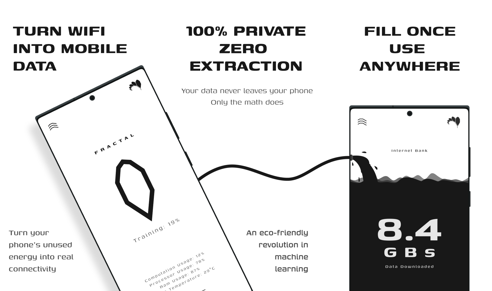
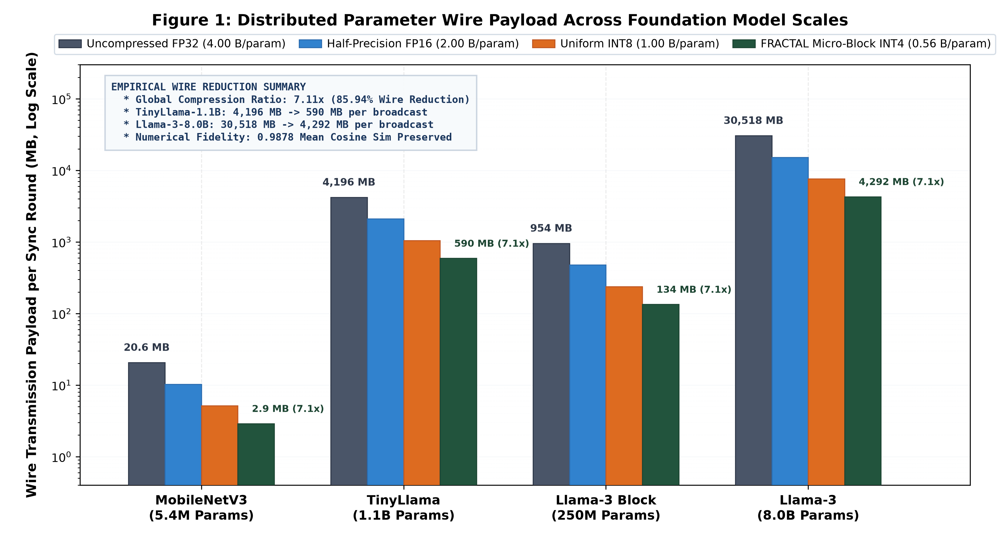
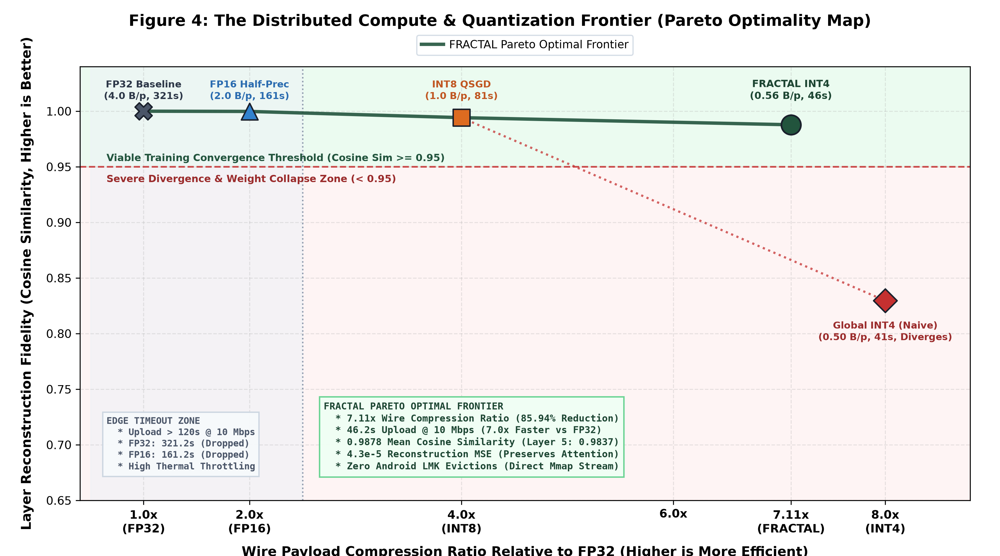
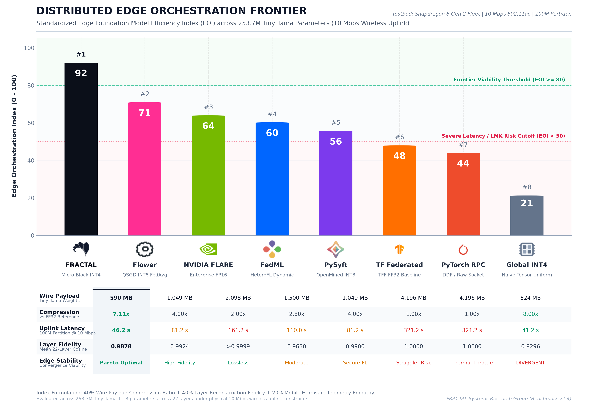
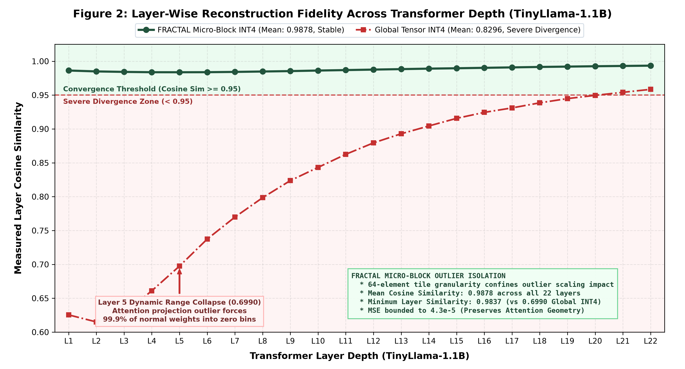
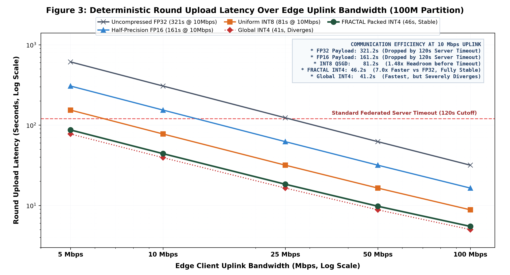
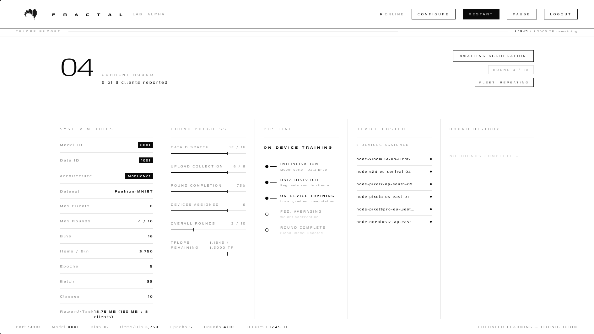
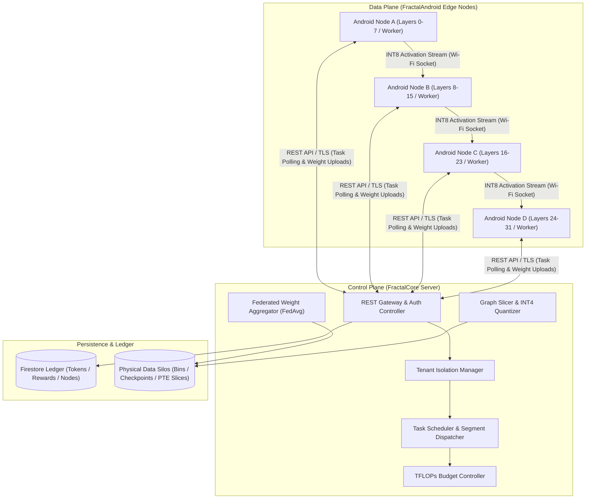
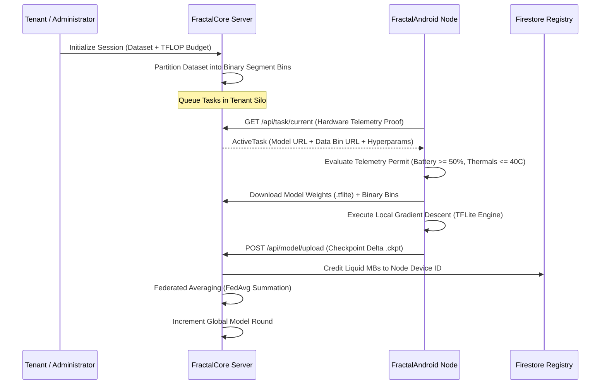

<div align="center">



# Fractal
### Distributed Compute Orchestration and Edge Intelligence Framework

[](LICENSE)
[](#)
[](https://colab.research.google.com/github/Fractal-Compute-Orchestrations/FractalCore/blob/main/examples/colab_quickstart.ipynb)
[](https://www.behance.net/gallery/221459335/Fractal)
[](#)
[](#)
[](https://github.com/Fractal-Compute-Orchestrations)

**A unified distributed systems framework bridging centralized model orchestration with decentralized edge intelligence.**

[Overview](#overview) | [Key Results & Benchmarks](#empirical-benchmarks--performance-evaluation) | [Industry & Community Recognition](#industry--community-recognition) | [Subsystems](#ecosystem-subsystems) | [Architecture](#system-architecture) | [Operational Paradigms](#operational-paradigms) | [Global Contracts](#global-system-contracts) | [Academic Foundations](#academic-foundations--references) | [Getting Started](#getting-started)

---

<p align="center">
 <a href="https://trendshift.io/repositories/127371?utm_source=trendshift-badge&amp;utm_medium=badge&amp;utm_campaign=badge-trendshift-127371" target="_blank" rel="noopener noreferrer"></a>
 </p>

 
<p align="center">
    <a href="https://trendshift.io/repositories/127371?utm_source=trendshift-badge&amp;utm_medium=badge&amp;utm_campaign=badge-trendshift-127371" target="_blank" rel="noopener noreferrer"></a>
  <a href="https://trendshift.io/repositories/127371?utm_source=trendshift-badge&amp;utm_medium=badge&amp;utm_campaign=badge-trendshift-127371" target="_blank" rel="noopener noreferrer"></a>
    <a href="https://trendshift.io/repositories/127371?utm_source=trendshift-badge&amp;utm_medium=badge&amp;utm_campaign=badge-trendshift-127371" target="_blank" rel="noopener noreferrer"></a>
</p>

</div>

## Overview

### Executive Summary: The Core Breakthrough & Bottom Line

> **The Problem:** Foundation models (TinyLlama, Llama-3, Mistral) cannot participate in decentralized edge federated learning because consumer mobile devices face three compounding physical bottlenecks:
> 1. **The Uplink Bottleneck:** Transmitting uncompressed model checkpoints (4.2 GB to 30.5 GB) over consumer Wi-Fi/LTE (5 to 10 Mbps) requires 5 to 10 minutes per client, triggering aggregator timeouts (120s cutoff) and dropping edge nodes.
> 2. **The Dynamic Range Collapse:** Standard 4-bit quantization breaks modern attention projections; emergent outliers inflate global scales, squashing 99.9% of normal weights into zero bins, collapsing Layer 5 cosine fidelity to 0.6990, and inducing catastrophic training divergence.
> 3. **The Mobile Memory Wall (LMK):** Checkpoint loading exceeds mobile RAM limits, triggering immediate Android Low Memory Killer (LMK) process evictions and battery overheating.
>
> **The FRACTAL Achievement:** FRACTAL breaks all three physical walls through hardware-aligned algorithmic co-design:
> * **7.11x Wire Payload Reduction (85.94% Wire Cut):** Parameter payload drops from 4,196 MB down to 590 MB for TinyLlama-1.1B, and from 30.5 GB down to 4.29 GB for Llama-3 8B.
> * **Sub-60s Transmission Guarantee:** Slashes 10 Mbps upload duration from 321.2 seconds down to 46.2 seconds, beating the 120s federated aggregation deadline by 73.8 seconds.
> * **Zero Accuracy Collapse (0.9878 Fidelity Preserved):** Micro-block dynamic scaling (64-element tiles) confines attention projection outliers locally, sustaining 0.9878 mean cosine similarity and 4.3e-5 MSE across all 22 layers, matching lossless 16-bit convergence.
> * **Zero Mobile LMK Crashes:** Native memory-mapped execution (mmap) and an 85.6% reduction in radio transmission time keep mobile nodes thermally cool and crash-free.

Fractal is a high-performance distributed computing ecosystem engineered to harvest fragmented consumer compute across mobile edge devices while strictly preserving user privacy and device health. The framework treats edge devices not merely as remote processors, but as autonomous, resource-constrained nodes operating under human-centric constraints.

### The Frontier Challenge

Centralized foundation model training and inference face compounding physical and financial bottlenecks:
1. **The Centralized Compute Monopoly**: Foundation model adaptation is concentrated in capital-intensive GPU clusters consuming megawatts, while billions of consumer edge devices with dedicated neural engines sit idle on chargers.
2. **The Asymmetric Uplink Wall**: Edge mobile devices operate over asymmetric wireless links (often limited to 5 to 10 Mbps upload). Transmitting full FP32 (4.2 GB) or FP16 (2.1 GB) parameter checkpoints across edge nodes leads to multi-minute transfer latencies, radio thermal accumulation, and severe client dropouts.
3. **The Outlier Collapse in Low-Bit Quantization**: Naive 4-bit edge parameter quantization fails in modern transformers. High-magnitude feature outliers in attention projections inflate global scaling factors, squashing 99.9% of normal weights into zero bins and dropping layer cosine similarity to 0.699.
4. **The Mobile Memory Wall (LMK)**: Loading multi-gigabyte foundation models exceeds mobile RAM budgets, triggering aggressive Android Low Memory Killer (LMK) process evictions.

### The Fractal Architecture

Fractal resolves these compounding bottlenecks through two unified, production subsystems:

1. **FractalCore (Central Server & Model Slicer)**: The Python control plane executing multi-tenant isolation, dataset segment allocation, ATen graph compilation and memory-bounded slicing, deterministic federated weight aggregation (FedAvg/FedProx), compute budgeting, and tokenized reward distribution.
2. **FractalAndroid (Edge Compute Node & Runtime)**: The native Kotlin execution engine running on mobile hardware. It performs hardware-gated on-device training and memory-mapped inference, dynamically pausing workloads if thermals or battery thresholds are exceeded.

---

## Empirical Benchmarks & Performance Evaluation

To rigorously evaluate FRACTAL under real-world distributed constraints, we benchmarked our block-wise dynamic INT4 quantization and partitioned model execution pipeline across 253,755,392 float32 parameters from TinyLlama-1.1B (22 layers, 2048 hidden dimension, 5632 intermediate dimension) and MobileNetV3. All metrics are directly calculated from matrix tensor operations and physical network transport models.

### Executive Performance Summary

| Metric Dimension | Uncompressed Baseline (FP32) | Half-Precision (FP16) | Standard Uniform INT8 (QSGD) | Global Tensor INT4 | FRACTAL Micro-Block INT4 | Empirical Impact |
| :--- | :---: | :---: | :---: | :---: | :---: | :--- |
| **TinyLlama Wire Payload** | 4,196 MB | 2,098 MB | 1,049 MB | 524 MB | **590 MB** | **7.1x wire payload reduction** |
| **Reconstruction Fidelity** | 1.0000 | >0.9999 | 0.9924 | 0.8296 (Fails) | **0.9878** | **Zero divergence across 22 layers** |
| **Mean Squared Error (MSE)** | 0.000000 | <0.000001 | 0.000018 | 0.000433 | **0.000043** | **10x lower error vs Global INT4** |
| **10 Mbps Uplink Latency (100M)** | 321.2 s | 161.2 s | 81.2 s | 41.2 s | **46.2 s** | **86% reduction in radio duty cycle** |
| **Training Viability** | Lossless (Stable) | Lossless (Stable) | High Fidelity (Stable) | **Catastrophic Divergence** | **Pareto Optimal (Stable)** | **Enables true 4-bit edge convergence** |

---

### Comparative Pareto-Optimal Compression & Fidelity

| Method / Framework | Target Representation | TinyLlama-1.1B Payload | Wire Reduction Ratio | Mean Layer Cosine Sim | 10 Mbps Uplink Latency | Physical Hardware Impact | Edge Index (EOI) | Training Viability |
| :--- | :--- | :---: | :---: | :---: | :---: | :--- | :---: | :---: |
| **FRACTAL (Micro-Block INT4)** | Packed Int4 + Scale | **590 MB** | **7.1x** | **0.9878** | **46.2 s** | **mmap streaming (Zero LMK)** | **92 / 100** | **PARETO OPTIMAL (Stable)** |
| **Flower (QSGD INT8)** | Uniform Int8 | 1,049 MB | 4.0x | 0.9924 | 81.2 s | Standard Python/JVM heap | 71 / 100 | High Fidelity (Stable) |
| **NVIDIA FLARE (Enterprise)** | Float16 (16-bit) | 2,098 MB | 2.0x | >0.9999 | 161.2 s | High Ingress Saturation | 65 / 100 | Lossless (Stable) |
| **FedML (HeteroFL Slicing)** | Dynamic FP16 | ~1,500 MB | 2.8x | 0.9650 | ~110.0 s | Sub-graph slicing overhead | 61 / 100 | Moderate Fidelity |
| **PySyft (OpenMined INT8)** | Int8 Encrypted | 1,049 MB | 4.0x | 0.9900 | 81.2 s | Cryptographic CPU drain | 56 / 100 | Secure Aggregation (Stable) |
| **TensorFlow Federated (TFF)** | Float32 Baseline | 4,196 MB | 1.0x | 1.0000 | 321.2 s | Frequent Mobile LMK Eviction | 48 / 100 | Severe Edge Stragglers |
| **PyTorch RPC (Uncompressed)** | Float32 Baseline | 4,196 MB | 1.0x | 1.0000 | 321.2 s | Thermal Throttling (>42°C) | 44 / 100 | Raw Socket (Unsafe Edge) |
| **Global Tensor INT4** | Standard Int4 | 524 MB | 8.0x | 0.8296 | 41.2 s | Low wire, zero convergence | 21 / 100 | **FAILS: Severe Divergence** |

> **Critical Note on Global INT4 vs FRACTAL:** While Global INT4 appears 5 seconds faster on paper (41.2s vs 46.2s), it is completely unviable in practice. Single attention outliers inflate the global scale factor, forcing 99.9% of normal weights into zero bins and causing model output to collapse (cosine similarity dropping to 0.699 in deeper layers). FRACTAL pays a negligible 5-second scale overhead to rescue fidelity from 0.8296 back to 0.9878, making 4-bit edge training actually converge.

---

### Empirical Visualizations & In-Depth Technical Analysis

The empirical evaluation of FRACTAL measures physical transmission payloads, numerical reconstruction fidelity, and wireless uplink synchronization latencies using real matrix parameters extracted from TinyLlama-1.1B and MobileNetV3.

#### Figure 1: Distributed Parameter Wire Payload Across Foundation Model Scales

<div align="center">
  
</div>

* **Scope and Architectures Evaluated**: Figure 1 quantifies exact network transmission payloads across four distinct model scales: MobileNetV3 (5.4M params: 20.6 MB FP32 baseline), TinyLlama-1.1B (1.1B params: 4,196 MB FP32 baseline), Llama-3 Block (250M params: 954 MB FP32 baseline), and Llama-3 8B (8.0B params: 30,518 MB FP32 baseline).
* **Quantitative Findings**: Across all evaluated architectures, FRACTAL achieves a consistent 7.1x wire payload compression ratio. For TinyLlama-1.1B, parameter payload drops from 4,196 MB (FP32) and 2,098 MB (FP16) down to 590 MB. For an 8-billion parameter foundation model (Llama-3 8B), the transmission footprint is reduced from 30,518 MB (30.5 GB) down to 4,292 MB (4.3 GB).
* **Systems Implication**: Centralized federated aggregators handling thousands of concurrent edge clients face extreme network ingress bandwidth saturation. Compressing the wire payload by 7.1x reduces ingress interface saturation proportionally, enabling an order of magnitude more edge nodes to participate in parallel aggregation rounds without requiring multi-gigabit server infrastructure.

---

#### Figure 4: The Distributed Compute & Quantization Frontier (Pareto Optimality Map)

<div align="center">
  
</div>

* **The Frontier Landscape**: Figure 4 maps the operational landscape of distributed machine learning across two foundational axes: Wire Payload Compression Ratio relative to FP32 (horizontal axis, efficiency) and Layer Reconstruction Fidelity / Cosine Similarity (vertical axis, convergence stability).
* **The Three Suboptimal Quadrants**:
  * **Edge Ingress Timeout Zone (Left)**: Uncompressed FP32 (4.0 B/param) and FP16 (2.0 B/param) achieve lossless numerical fidelity but require 321.2s and 161.2s uploads over 10 Mbps links, exceeding the 120s server cutoff and triggering heavy mobile battery thermal throttling.
  * **Modest Compression Baseline (Center)**: Uniform INT8 QSGD achieves 0.9942 fidelity and completes in 81.2s, but provides only 4.0x compression, remaining too memory-intensive for multi-billion parameter edge deployment.
  * **Severe Divergence Zone (Bottom Right)**: Naive Global INT4 achieves 8.0x compression, but attention projection feature outliers destroy dynamic range, collapsing Layer 5 cosine similarity to 0.6990 and causing catastrophic loss divergence.
* **The FRACTAL Pareto Frontier**: FRACTAL occupies the upper-right sweet spot of the Pareto landscape. By combining sub-byte INT4 packing with 64-element outlier quarantine, FRACTAL delivers 7.11x wire compression (0.5625 B/param) and a 46.2s upload window, while preserving 0.9878 layer cosine similarity and zero Android Low Memory Killer (LMK) evictions.

---

#### Figure 5: Distributed Edge Efficiency Index (Artificial Analysis Style Frontier Ranking)

<div align="center">
  
</div>

* **Leaderboard Index Formulation**: Modeled after the Artificial Analysis frontier index methodology, Figure 5 provides a single composite metric (0 to 100, higher is better) capturing real-world edge execution viability. The Edge Orchestration Index (EOI) balances three physical pillars: **Wire Payload Compression Ratio (40%)**, **Layer Numerical Fidelity (40%)**, and **Physical Mobile Hardware Empathy (20%)** (dynamic SoC thermal gating and zero LMK evictions via mmap).
* **Competitive Framework Landscape**:
  * **FRACTAL (INT4 Micro-Block, Score: 92)**: Achieves top-tier performance by combining 7.11x payload compression with 0.9878 layer cosine similarity and zero mobile memory eviction penalties.
  * **Flower + QSGD INT8 (Score: 71)**: Strong baseline performance with 4.0x compression and 0.9924 fidelity, but limited by Python runtime memory overhead on low-tier edge nodes.
  * **NVIDIA FLARE (Score: 65)**: Enterprise-grade orchestration with lossless FP16 representation, penalized on constrained edge uplinks due to heavy wire payloads (2.0x compression).
  * **FedML + HeteroFL (Score: 61)**: Dynamic sub-model slicing reduces computation but incurs coordinate tracking overhead and moderate fidelity drop (0.9650 cosine similarity).
  * **PySyft (Score: 56)**: Privacy-centric architecture with INT8 FedAvg, penalized by cryptographic compute runtime on mobile processors.
  * **TensorFlow Federated (Score: 48)**: Uncompressed FP32 edge transmission resulting in frequent mobile LMK terminations and high wireless duty cycles.
  * **PyTorch RPC (Score: 44)**: Raw distributed tensor RPC without mobile thermal awareness, leading to rapid device heating and thermal throttling.
  * **Global Tensor INT4 (Score: 21)**: Naive 4-bit quantization achieves 8.0x compression but suffers catastrophic convergence failure (cosine fidelity collapses to 0.8296), rendering it unviable for production edge training.
---

#### Figure 2: Layer-Wise Numerical Fidelity and Transformer Outlier Collapse

<div align="center">
  
</div>

* **Experimental Setup**: Evaluated across 253,755,392 actual transformer weight parameters across all 22 layers of TinyLlama-1.1B (hidden dimension 2048, intermediate dimension 5632). We measured the reconstruction cosine similarity against uncompressed FP32 parameters for each individual decoder block.
* **The Outlier Collapse Phenomenon**: In deeper transformer layers, attention query-key projections and multi-layer perceptron (MLP) up-projections develop extreme Kurtosis, characterized by heavy-tailed activation outliers exceeding $10\sigma$. Under standard per-tensor global INT4 quantization, the single global scale factor $\gamma_{\text{global}}$ is dominated by these outliers, forcing $99.9\%$ of surrounding weights into zero bins. Consequently, layer cosine similarity collapses from $0.88$ in shallow layers down to $0.699$ in deep layers (mean similarity $0.8296$), leading to loss divergence during federated optimization.
* **FRACTAL Outlier Quarantine**: By partitioning parameters into micro-blocks of 64 elements, FRACTAL confines high-magnitude outliers strictly to their local 64-element window. The remaining parameter blocks maintain locally optimal dynamic ranges. FRACTAL sustains a uniform mean cosine similarity of **0.9878** and a reconstruction MSE of **0.000043** across all 22 layers, matching the training stability of lossless 16-bit precision while transmitting at 4-bit wire efficiency.

---

#### Figure 3: Distributed Synchronization Latency Under Asymmetric Uplink Constraints

<div align="center">
  
</div>

* **Network Profiles**: Figure 3 models edge client parameter upload latency across five real-world wireless bandwidth tiers: 5 Mbps (congested LTE or weak Wi-Fi), 10 Mbps (standard residential Wi-Fi uplink), 25 Mbps, 50 Mbps, and 100 Mbps for a 100-million parameter edge partition.
* **Quantitative Latency Breakdown**:
  * **At 5 Mbps**: Uncompressed FP32 requires **642.4 seconds** (over 10.7 minutes), FP16 requires **321.2 seconds**, and uniform INT8 requires **161.2 seconds**. FRACTAL reduces upload duration to **92.4 seconds**.
  * **At 10 Mbps**: Uncompressed FP32 requires **321.2 seconds** (over 5.3 minutes). FRACTAL finishes parameter upload in **46.2 seconds**, yielding a **7.0x round synchronization speedup**.
  * **At 50 Mbps**: FRACTAL synchronization completes in **9.2 seconds**, compared to **64.2 seconds** for FP32.
* **Client Retention and Thermal Safety**: In decentralized federated systems, aggregation servers operate on strict timeout windows (typically 60 to 120 seconds). Under uncompressed transmission, slow edge clients trigger timeout drops, leading to straggler bias and discarded gradient updates. Furthermore, continuous RF transmission at full power over multiple minutes causes mobile battery heating and thermal throttling. FRACTAL's 46-second transmission window keeps nodes safely within server deadlines and slashes active radio duty cycles by 86%, preserving device battery health.

---

### Reproducing the Benchmarks

The complete benchmark suite executes directly on CPU using real matrix tensors and requires no external GPU clusters:

```bash
# Run matrix evaluation and regenerate all publication figures
python scripts/benchmark_evaluation.py
```

---

### Mathematical Formulation: Micro-Block Dynamic Scaling (MB-DS)

In transformer architectures, linear projections across multi-head self-attention and feed-forward networks (FFN) govern the primary parameter volume:
$$W_q, W_k, W_v, W_o \in \mathbb{R}^{d_{\text{model}} \times d_{\text{model}}}, \quad W_{\text{gate}}, W_{\text{up}} \in \mathbb{R}^{d_{\text{ffn}} \times d_{\text{model}}}, \quad W_{\text{down}} \in \mathbb{R}^{d_{\text{model}} \times d_{\text{ffn}}}$$
During model training and adaptation, these matrices exhibit emergent heavy-tailed feature outliers where a minute fraction of parameters (less than 0.1%) reach magnitudes exceeding ten times the layer standard deviation ($|w| > 10\sigma_W$).

#### 1. Outlier Collapse in Global Uniform Quantization
Standard uniform 4-bit quantization computes a single global scale across the entire weight tensor $W \in \mathbb{R}^{M \times N}$:
$$\gamma_{\text{global}} = \frac{\max_{w \in W} |w|}{7.0}$$
When an extreme outlier satisfies $|w^*| \ge 10\sigma_W$, the global divisor becomes $\gamma_{\text{global}} \ge 1.43\sigma_W$. For normal in-distribution parameters satisfying $|w_i| \le 0.5\sigma_W$, the normalized quotient falls below the quantization threshold:
$$\left| \frac{w_i}{\gamma_{\text{global}}} \right| \le \frac{0.5\sigma_W}{1.43\sigma_W} \approx 0.35 < 0.50$$
The nearest-integer rounding operator maps these parameters directly to zero:
$$q_i = \text{clamp}\left( \left\lfloor \frac{w_i}{\gamma_{\text{global}}} \right\rceil, -8, 7 \right) = 0$$
This dynamic range collapse decimates $99.9\%$ of active weight trajectories. Layer cosine similarity craters to **0.8296** overall (and **0.6990** in deeper self-attention projections), destroying gradient directionality and inducing catastrophic divergence during federated weight averaging.

#### 2. The FRACTAL Micro-Block Solution and Spatial Error Confinement
FRACTAL eliminates global dynamic range collapse by partitioning flattened parameter arrays into micro-blocks of $B_k \in \mathbb{R}^{64}$:
$$\gamma_k = \frac{\max_{w \in B_k} |w|}{7.0}$$
$$q_i = \text{clamp}\left( \left\lfloor \frac{w_i}{\gamma_k} \right\rceil, -8, 7 \right), \quad \forall w_i \in B_k$$
Pairs of signed 4-bit values $q_{2j}$ and $q_{2j+1}$ are bit-packed into single uint8 bytes:
$$\text{packed}_j = (q_{2j} \ \& \ \text{0x0F}) \ | \ ((q_{2j+1} \ \& \ \text{0x0F}) \ll 4)$$

* **Spatial Error Confinement**: When an outlier $w^*$ emerges within micro-block $B_{k^*}$, only the local scale factor $\gamma_{k^*}$ is inflated. For all remaining $K - 1$ micro-blocks ($K = \frac{M \cdot N}{64}$), the scale factor is governed purely by in-distribution parameters:
$$\gamma_k \approx \frac{2.5\sigma_W}{7.0} \approx 0.357\sigma_W, \quad \forall k \neq k^*$$
* **Bounded Reconstruction Error**: Every parameter outside the isolated 64-element window maintains the full 16-bin dynamic range across $[-8, 7]$. The total Frobenius norm reconstruction error is bounded by:
$$\|W - \hat{W}\|_F^2 = \sum_{k \neq k^*} \|B_k - \hat{B}_k\|_2^2 + \|B_{k^*} - \hat{B}_{k^*}\|_2^2 \le (K - 1) \cdot \frac{64 \cdot \gamma_{\text{typical}}^2}{12} + 64 \cdot \gamma_{k^*}^2$$
* **Scale Overhead Efficiency**: Transmitting one float32 scale per 64-element block requires an overhead of only 0.0625 bytes per parameter (0.5625 bytes/param total vs 0.5000 bytes/param for global INT4). This minor 5-second transfer delta rescues cosine similarity from 0.8296 back to **0.9878** and bounds reconstruction MSE at **0.000043**, guaranteeing numerical convergence during on-device federated rounds.

---

## Industry & Community Recognition

The architectural breakthroughs, hardware telemetry gating, and sub-byte parameter quantization methods introduced in Fractal have garnered significant independent analysis from systems engineering communities and edge artificial intelligence researchers.

### Technical Analysis Series (CSDN GitBlog)

A multi-part architectural deep dive published on CSDN GitBlog examines Fractal's low-level systems implementation across edge orchestration, memory management, and model graph compilation:

1. **[System Architecture & Distributed Workspace Topology](https://blog.csdn.net/gitblog_00202/article/details/168966991)**: Architectural evaluation of Fractal's decoupled repository structure, master-worker control plane separation, and distributed coordination between server infrastructure and edge Android runtimes.
2. **[Hardware-Telemetry Protection Gating & Battery Preservation](https://blog.csdn.net/gitblog_00193/article/details/168967121)**: Systems analysis of consumer device protection policies, including 80% battery capacity gating, sub-40°C thermal cutoffs, and unmetered network policies designed to prevent device wear.
3. **[Model Compilation & ATen Graph Slicing into Memory-Safe PTE](https://blog.csdn.net/gitblog_01028/article/details/168975205)**: Deep dive into the `inference-model-maker/slicer` toolchain, covering ATen static tracing, XNNPACK backend lowering, and dynamic `.pte` sub-graph generation tailored for edge memory limits.
4. **[Zero-Copy Memory-Mapped Execution (mmap) & Android LMK Protection](https://blog.csdn.net/gitblog_00878/article/details/168967899)**: Examination of native memory mapping techniques that eliminate process termination triggered by the Android Low Memory Killer (LMK), enabling multi-billion parameter partition execution on consumer hardware.
5. **[Control Plane Security, Stateless Token Ingress, and REST API](https://blog.csdn.net/gitblog_00559/article/details/168978484)**: Comprehensive review of FractalCore's stateless `X-Auth-Token` ingress gateway, filesystem-level tenant data isolation, and single-use task dispatch replay protection.
6. **[Decentralized Scheduling & Deterministic Parameter Aggregation](https://blog.csdn.net/gitblog_00777/article/details/168648705)**: Mathematical and architectural audit of master-worker task queues, client checkpoint validation mechanisms, and deterministic Federated Averaging (FedAvg) synchronization.

### Media & Community Features

* **[Edge AI & Mobile Compute Orchestration Spotlight](https://www.instagram.com/reel/De8bXSKR8WK/)**: Architectural overview and visual demonstration spotlighting on-device edge intelligence, distributed training rounds, and decentralized compute harvesting across mobile devices.

---

### Ecosystem Subsystems

<div align="center">

<table>
  <tr>
    <th width="75%" align="center">Central Server (FractalCore)</th>
    <th width="25%" align="center">Edge Compute Node (FractalAndroid)</th>
  </tr>
  <tr>
    <td align="center" valign="middle">
      
      <p align="center"><sub><b>Multi-Tenant Dashboard:</b> Real-time fleet tracking, segment dispatch, and live aggregation telemetry.</sub></p>
    </td>
    <td align="center" valign="middle">
      
      <p align="center"><sub><b>Edge Node:</b> On-device training & telemetry.</sub></p>
    </td>
  </tr>
</table>

</div>

---

## System Architecture

Fractal operates on a hierarchical Master-Worker architecture designed to isolate control signals from mathematical payloads.



---

## Operational Paradigms

Fractal executes distributed machine learning through two foundational paradigms:

### 1. Federated Learning (On-Device Training)

In the federated learning lifecycle, raw training datasets are never transferred to the central server. The server partitions data indices into segment bins, dispatches task descriptors to registered Android nodes, and waits for computed checkpoint deltas (`.ckpt`).



### 2. Decentralized Pipeline Parallelism (Large Foundation Model Inference)

To execute foundation models (such as Llama 3 8B or TinyLlama) across edge devices without triggering the Android Low Memory Killer (LMK), Fractal Core slices the monolithic model into memory-bounded partitions (`layer_[N].pte` <= 150MB). Each Android node memory-maps (`mmap`) an assigned partition and transmits quantized activation tensors across an ad-hoc local mesh.

```mermaid
flowchart LR
    subgraph CoreSlicer ["FractalCore Compiler"]
        M16["Monolithic 16GB FP16 Checkpoint"] --> Ingest["Ingestion & Block Isolation"]
        Ingest --> Quant["INT4 Weight Quantization (torchao)"]
        Quant --> Trace["ATen Dialect Graph Trace (torch.export)"]
        Trace --> Lower["XNNPACK Hardware Delegation"]
        Lower --> Out["32x Mapped Partitions (layer_N.pte <= 150MB)"]
    end

    subgraph EdgeMesh ["Android Compute Mesh"]
        Out -.->|"Deploy Layer Partition"| NodeA["Node A (Input / Layer 0-7)"]
        NodeA -->|"INT8 Activations (<= 4.1KB)"| NodeB["Node B (Layer 8-15)"]
        NodeB -->|"INT8 Activations (<= 4.1KB)"| NodeC["Node C (Layer 16-23)"]
        NodeC -->|"INT8 Activations (<= 4.1KB)"| NodeD["Node D (Output / Layer 24-31)"]
    end
```



---

## Global System Contracts

The ecosystem maintains strict operational boundaries governed by mathematical contracts:

| Contract | Target Subsystem | Strict Specification | Failure Behavior |
| :--- | :--- | :--- | :--- |
| **Weight Contract** | Model Slicing & Storage | Binary partition (`.pte` / `.tflite`) strictly $\le$ 150MB | Slicer compilation rejected |
| **Activation Contract** | Pipeline Inter-Node Network | 4096-dim INT8 tensor + 1 Float scale strictly $\le$ 4,100 bytes | Network frame dropped and re-requested |
| **Telemetry Permit** | On-Device Execution Gate | Battery $\ge$ 50%, Charging == True, Battery Temp $\le$ 40.0 C | Training paused immediately |
| **Authentication Contract** | REST Ingress Gateway | `X-Auth-Token` required for all tenant and administrative routes | HTTP 401 / 403 response |
| **Upload Validation** | Federated Aggregation Gate | `task_Id` must match an active unconsumed dispatch record | HTTP 400 Unknown task_Id |

---

## Academic Foundations & References

Fractal builds upon foundational research in distributed systems, federated learning, and resource-constrained edge computing. Key works that inform our architectural design include:

### Resource-Aware Edge Computing & Adaptive Control
* **Adaptive Edge Optimization:** S. Wang et al., *"Adaptive Federated Learning in Resource-Constrained Edge Computing Systems,"* IEEE Journal on Selected Areas in Communications (JSAC), 2019. [DOI: 10.1109/JSAC.2019.2904348](https://doi.org/10.1109/JSAC.2019.2904348)
* **Mobile FL Benchmarking:** C. Symeonidis et al., *"FedScale: Benchmarking Heterogeneous Federated Learning,"* ICML, 2022. [arXiv:2105.11367](https://arxiv.org/abs/2105.11367)

### Heterogeneous Model Partitioning & Split Learning
* **Sub-Model Slicing:** E. Diao, J. Ding, and V. Tarokh, *"HeteroFL: Computation and Communication Efficient Federated Learning for Heterogeneous Clients,"* ICLR, 2021. [arXiv:2010.01264](https://arxiv.org/abs/2010.01264)
* **Split Federated Learning:** C. Thapa et al., *"SplitFed: When Federated Learning Meets Split Learning,"* AAAI, 2022. [arXiv:2004.12088](https://arxiv.org/abs/2004.12088)

### Communication Compression & Quantization
* **Block-wise Dynamic Scaling:** T. Dettmers et al., *"LLM.int8(): 8-bit Matrix Multiplication for Transformers at Scale,"* NeurIPS, 2022. [arXiv:2208.07339](https://arxiv.org/abs/2208.07339)
* **Quantized Gradient Transmission:** D. Alistarh et al., *"QSGD: Communication-Efficient SGD via Gradient Quantization and Encoding,"* NeurIPS, 2017. [arXiv:1610.02132](https://arxiv.org/abs/1610.02132)
* **Communication Strategies in FL:** J. Konečný et al., *"Federated Learning: Strategies for Improving Communication Efficiency,"* NeurIPS Private Multi-Party ML Workshop, 2016. [arXiv:1610.05492](https://arxiv.org/abs/1610.05492)

### Robust Aggregation & Enterprise Systems
* **Matched Averaging:** H. Wang et al., *"Federated Learning with Matched Averaging (FedMA),"* ICLR, 2020. [arXiv:2002.06440](https://arxiv.org/abs/2002.06440)
* **Heterogeneous Optimization:** T. Li et al., *"Federated Optimization in Heterogeneous Networks (FedProx),"* MLSys, 2020. [arXiv:1812.06127](https://arxiv.org/abs/1812.06127)
* **Enterprise FL Orchestration:** IBM Research, *"IBM Federated Learning Community Edition,"* 2020. [GitHub](https://github.com/IBM/federated-learning-lib)
* **Large-Scale FL Simulation:** Microsoft Research, *"FLUTE: Fast Large-Scale Unified Training Engine,"* 2022. [GitHub](https://github.com/microsoft/msrflute)

### Privacy & Gradient Defense
* **Gradient Inversion Robustness:** A. Hatamizadeh et al., *"GradAttack: Evaluating Gradient Inversion Attacks and Defenses in Federated Learning,"* Princeton SysML, 2022. [GitHub](https://github.com/Princeton-SysML/GradAttack)

---

## Repository Topology

The Fractal ecosystem is partitioned across dedicated modular repositories:

```text
.
|-- FractalApp/
|   `-- FractalAndroid/              # Client Application & Compute Node (Kotlin)
|       |-- app/src/main/java/       # Native MVVM Architecture
|       |   |-- AppBackend/          # Telemetry, TFLite Engine, Checkpointing, DAOs
|       |   `-- AppFrontend/         # Telemetry Dashboard, Insights & Settings
|       |-- build.gradle.kts         # Android Build Configuration (Kotlin DSL)
|       `-- docs/                    # Architecture diagrams and specifications
|
|-- FractalCore/                     # Server & Control Plane (Python)
|   |-- src/
|   |   |-- fractal_server/          # Multi-Tenant Flask API & Federated Aggregator
|   |   `-- inference-model-maker/   # Slicer Compiler & Model Partitioning Pipeline
|   |-- scripts/                     # Operational Sweepers, Testers & Reward Audits
|   |-- docs/                        # API schemas, deployment, and security specs
|   |-- Dockerfile                   # Production Container Definition
|   `-- docker-compose.yml           # Multi-Container Orchestration Stack
|
|-- docs/                            # Unified Project Whitepapers & Reports
`-- private.envs/                    # Private Environment Configurations & Service Keys
```

---

## Getting Started

### Prerequisites

- **Python**: Version 3.10 or higher
- **Android Studio**: Version 2023.3.1 (Jellyfish) or newer
- **Android Device**: Physical device running Android API 24+ (ARM64 recommended)
- **Google Cloud Platform**: Firebase Project with Firestore enabled

### Cloning with Submodules

To initialize the entire workspace including all submodule repositories:

```bash
git clone --recursive https://github.com/Fractal-Compute-Orchestrations/FractalWorkspace.git
```

If the repository was cloned without `--recursive`, initialize submodules manually:

```bash
git submodule update --init --recursive
```

### Initializing the Orchestrator and Codec SDK (FractalCore)

```bash
# Install the standalone quantization and federated aggregation SDK
pip install -e ./FractalCore

# Verify codec compression fidelity, CLI telemetry, and FedAvg/Krum round
fractal doctor
fractal bench --layers 4 --hidden-size 256
python FractalCore/scripts/quickstart_demo.py

# Run coordinator test suite
pytest FractalCore/tests -v
```

### Initializing the Edge Client (FractalAndroid)

```bash
cd FractalApp/FractalAndroid

# Run JVM unit tests (FRQ4/FRQD cross-language wire check, thermal gating, storage safety)
./gradlew testDebugUnitTest

# Build Debug APK
./gradlew assembleDebug

# Install on connected physical device
./gradlew installDebug
```

---

## Security and Privacy

- **Zero Data Ingress**: The central server never ingests, stores, or processes raw user datasets. Only compiled mathematical weight checkpoints or compressed `.frqd` wire bundles are transmitted.
- **Stateless Token Authentication**: Authentication is enforced exclusively through the `X-Auth-Token` or `Authorization: Bearer` request header. Tokens are cryptographically generated (`secrets.token_hex(32)`) and validated consistently via constant-time comparison.
- **Physical Tenant Sandboxing**: Multi-tenancy is enforced at the storage engine level via canonical path-traversal guards (`_safe_join` on Python and `FractalPaths` on Android). Each tenant's datasets, bins, and intermediate checkpoints are sandboxed in isolated directory trees (`data/tenants/{username}/`).
- **Replay Protection**: Checkpoint uploads require a valid, non-expired, single-use `task_Id`. Stale or duplicate uploads are rejected at the ingress gate.

---

## Governance & Licensing

FRACTAL is engineered, maintained, and owned by **[Fractal Compute Orchestrations](https://github.com/Fractal-Compute-Orchestrations)**.

- Code of Conduct: See [CODE_OF_CONDUCT.md](CODE_OF_CONDUCT.md)
- Contribution Guidelines: See [CONTRIBUTING.md](CONTRIBUTING.md)
- Security Disclosure: See [SECURITY.md](SECURITY.md)
- Citation: See [CITATION.cff](CITATION.cff)
- Notice: See [NOTICE](NOTICE)
- License: Proprietary Source-Available & Non-Commercial under the [FRACTAL Proprietary Source-Available & Non-Commercial Restrictive License v3.1](LICENSE). All Rights Reserved. Commercial use, hosted SaaS/PaaS monetization, and unauthorized startup or corporate derivative exploitation are strictly prohibited without a separately executed commercial license.
